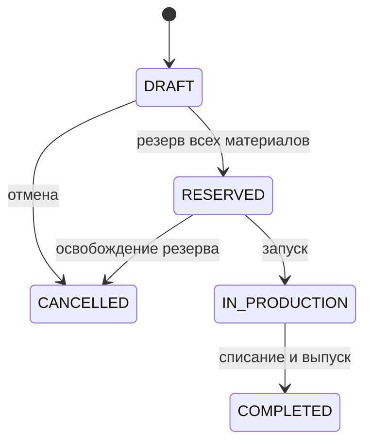

# Архитектура и бизнес-правила

Один Python-процесс API и одна транзакционная PostgreSQL-база. Worker — отдельный
процесс того же приложения; бизнес-модули не разделены на микросервисы.

## Границы

| Модуль | Ответственность | Где находится |
|---|---|---|
| Catalog | Материалы, модели, рецептуры по размеру и цвету | `application/catalog.py` |
| Planning | Целочисленные единицы, расчёт потребности и потерь | `domain/planning.py` |
| Orders / Production | Снимок потребности, резерв, жизненный цикл партии, выпуск | `application/orders.py` |
| Purchasing | Закупка и частичная приёмка | `application/purchasing.py` |
| Persistence | Репозиторий, транзакции и ограничения БД | `infrastructure/repository.py`, `models.py`, `commands.py` |
| Access | JWT identity и policy decisions | `infrastructure/security.py`, `cerbos/` |
| Events / Reporting | Outbox, Inbox и проекция дневного выпуска | `infrastructure/events.py`, `worker.py` |
| HTTP | Входные Pydantic-контракты и composition root | `application/contracts.py`, `api/app.py` |

Приложение зависит от `FactoryRepository` (Protocol). SQLAlchemy скрыт внутри
реализации порта. Расчёт расхода не зависит от HTTP или БД.

## Инварианты

- У каждой записи бизнеса есть фабрика. Foreign keys состоят из ID и tenant ID.
- Склад: `0 ≤ reserved ≤ on_hand`. Свободный остаток — разница.
- Метры хранятся целым количеством тысячных метра; штуки — тысячными единицами,
  причём входное количество штук обязано быть целым. Дробные вычисления — Decimal.
- Расход по строкам заказа агрегируется перед округлением вверх; для штук результат
  округляется вверх до целой штуки. Процент потерь относится к базовому расходу.
- Для выбранной пары размер/цвет нужна рецептура. Заказ фиксирует её рассчитанный
  расход; редактирование BOM в этой версии отсутствует.
- Сначала операция захватывает переход состояния заказа условным UPDATE.
  Каждый складской UPDATE проверяет будущий остаток и резерв. Все позиции, журнал,
  аудит, Outbox и результат идемпотентности фиксируются одной транзакцией.
- Несколько материалов блокируются в одинаковом порядке по material ID.
- Запуск возможен только после резерва. Выпуск — только после запуска; повторное
  списание с новым ключом блокируется состоянием.
- Отмена производства после старта требует отдельного процесса учёта фактического
  расхода, поэтому MVP разрешает отмену только DRAFT/RESERVED.
- Приёмка блокирует строку закупки, ограничивает полученное заказанным и исключает
  повторную складскую проводку с тем же reference/material. При ошибке всё откатывается.

## Состояния заказа

## Доставка событий

Событие записывается с бизнес-изменением. Worker выбирает доступную строку с
`FOR UPDATE SKIP LOCKED` и фиксирует PROCESSING, claim ID и срок аренды, затем
вызывает Publisher вне транзакции захвата. Подтверждение проверяет claim ID:
прежний worker после повторного захвата не может подтвердить новую аренду.
После сбоя аренда истекает. Ошибки получают ограниченный экспоненциальный backoff,
после лимита — DEAD. API показывает состояние и число попыток.

Доставка допускает повтор. Inbox проверяет event ID и хэш содержимого; запись Inbox
и изменение отчёта атомарны. Это обеспечивает однократный эффект локального consumer,
а не обещание однократной доставки. Отчёт считает только `production.completed`
и не зависит от порядка остальных событий. Текущий Publisher использует локальную
SQL-проекцию; адаптер RabbitMQ/FastStream можно добавить без смены бизнес-команд.
Операторское повторное помещение DEAD-событий в очередь и мониторинговые алерты
требуют отдельного следующего этапа; автоматическое бесконечное переисполнение отсутствует.

## Соответствие требованиям скриншота

| Требование | Версия 0.1 |
|---|---|
| Python / FastAPI / Pydantic | Реализовано |
| SQLAlchemy / PostgreSQL | Async-адаптер и транзакционные операции реализованы; живой PostgreSQL требует отдельного прогона |
| Alembic | Исходная миграция подготовлена; автоматически не запускается |
| Zitadel / Cerbos | JWT-адаптер и policy-клиент, политики и тесты; реальный provider требует настройки |
| Docker / Dev Containers | Файлы запуска подготовлены; Docker в среде проверки отсутствует |
| pytest | Доменные, HTTP, конкурентные, авторизационные и fault-сценарии |
| Модульный монолит / границы | Каталог, заказы/производство, закупки, события; порт репозитория |
| Транзакции / retry / идемпотентность | Атомарные команды, защищённые балансы, Outbox/Inbox и аренды |
| CQRS отдельных read models | Дневной выпуск через асинхронную проекцию |
| Structured logs / observability | Request ID, время HTTP, аудит и состояние Outbox; tracing/metrics далее |
| RabbitMQ / Redis / FastStream / Dishka / Temporal / ClickHouse | Не реализовано; планируемые расширения |

Для следующего этапа наиболее содержателен частичный выпуск с фактическим расходом
и браком. Temporal имеет смысл для длительного согласования/ожидания поставки;
ClickHouse — когда появится достаточный объём аналитических событий.
Новые зависимости добавляются вместе с конкретной задачей и проверяемым эффектом.

## Первичные технические источники

- [SQLAlchemy async sessions](https://docs.sqlalchemy.org/en/20/orm/extensions/asyncio.html)
- [Alembic asyncio](https://alembic.sqlalchemy.org/en/latest/cookbook.html#using-asyncio-with-alembic)
- [FastAPI dependencies](https://fastapi.tiangolo.com/tutorial/dependencies/dependencies-with-yield/)
- [Zitadel claims](https://zitadel.com/docs/apis/openidoauth/claims)
- [Cerbos CheckResources API](https://docs.cerbos.dev/cerbos/latest/api/index.html)
